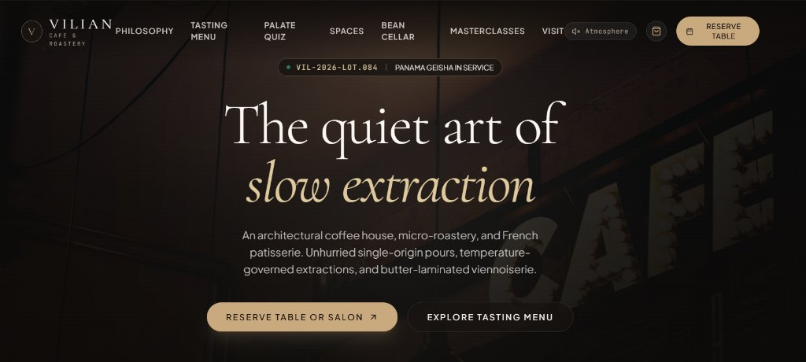
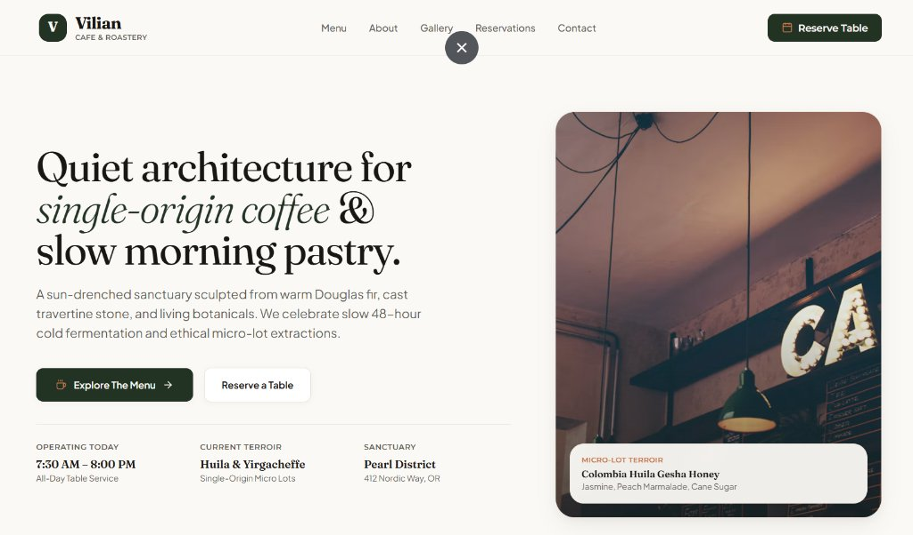

# unslop-business 🧼✨

<p align="center">
  <strong>An open Agent Skill for AI coding agents to build distinctive, editorial, conversion-focused business websites—never generic AI templates.</strong>
</p>

<p align="center">
  <a href="https://github.com/aniket-gedam/unslop-business/blob/main/LICENSE"></a>
  <a href="https://agentskills.io"></a>
  
  
  
</p>

---

Most AI coding agents generate websites that look suspiciously alike: dark neon glows, generic floating cards, meaningless buzzwords, and interchangeable SaaS-style layouts applied to local cafes, boutique shops, and hospitality brands.

**`unslop-business`** fixes this. It forces coding agents (Claude Code, Google Antigravity, OpenAI Codex, Cursor) to act as a **senior brand strategist, art director, and frontend engineer**. Before writing code, the agent extracts real design principles from benchmark references, defines a business-specific design fingerprint, and enforces a mandatory **Logo-Swap Test**.

---

## 📸 Before & After: The "Unslop" Effect

Here is a real example of the same business (**Vilian Cafe & Roastery**) generated with standard AI prompts vs. built with **`unslop-business`**:

### ❌ Before: Standard AI Output ("The Slop")
> *Dark moody background, low-contrast typography, gimmicky ambient buttons ("Palate Quiz", "Atmosphere audio"), zero practical business information (no operating hours, no address), and a layout that could be swapped with any generic dark bar.*

<p align="center">
  
</p>

### ✅ After: With `unslop-business` ("The Craft")
> *Warm, natural Douglas fir & travertine aesthetic, editorial typography pairing, structured operational metadata (operating hours, single-origin terroir, physical address), and clear conversion pathways ("Explore The Menu" & "Reserve a Table").*

<p align="center">
  
</p>

### ⚖️ Breakdown: Why It Matters

| Dimension | Standard AI Template ("Before") | Built with `unslop-business` ("After") |
| :--- | :--- | :--- |
| **Brand Identity** | Vague, interchangeable moody dark theme | Warm, tactile, sun-drenched architectural identity |
| **Information Architecture** | Gimmicky features (*"Atmosphere"* audio, *"Palate Quiz"*) | Vital customer essentials: Operating hours, micro-lot terroir, physical address |
| **Conversion Focus** | Ambiguous secondary actions | Clear dual CTA hierarchy: Primary (*"Explore The Menu"*) + Booking (*"Reserve a Table"*) |
| **Typography & Hierarchy** | Generic centered serif overlay with poor contrast | Crisp display serif paired with editorial grotesk body and scannable metadata tags |
| **The Logo-Swap Test** | **Failed.** Swap the logo, and it looks like a generic night club or crypto landing. | **Passed.** Content, structure, and imagery are intimately tied to a specialty roastery and bakery. |

---

## ⚡ Key Highlights

- 🛡️ **Mandatory Uniqueness Protocol:** Agents must create a [Design Identity Record](references/uniqueness-protocol.md) before coding. Two unrelated businesses never receive the same layout.
- 🔄 **The Logo-Swap Test:** If swapping the logo and photos makes the design work equally well for an unrelated business, the agent must reject it and rethink the composition.
- 🎯 **Conversion-First UX:** Every section directly serves visitor intent—reservations, menu discovery, local store visits, or product purchases.
- 🎨 **Editorial Design Tokens:** Establishes purposeful design tokens for typography, surfaces, rhythm, and responsive breakpoints rather than relying on default Tailwind templates.
- 🌐 **Benchmarked Against World-Class References:** Analyzes real-world boutique brands (e.g. specialty coffee houses, independent hospitality, high-end retail) to extract transferable layout patterns.
- 💻 **Stack-Agnostic Frontend:** Works smoothly with React, Next.js, Vue, Svelte, Astro, Tailwind CSS, or clean vanilla HTML/CSS.

---

## 📦 What's Inside

```text
unslop-business/
├── SKILL.md                          # Main agent instructions & 9-phase workflow
├── README.md                         # Project documentation & visual guide
├── LICENSE                           # MIT License
├── assets/                           # Visual before/after benchmarks & media
│   ├── before-generic-ai.jpg
│   └── after-unslop-design.jpg
├── references/                       # Core guidelines & design rules
│   ├── uniqueness-protocol.md        # Mandatory Design Fingerprint & Logo-Swap Test
│   ├── business-patterns.md          # Patterns for hospitality, retail, services, & local
│   ├── design-system.md              # Token structure for typography, surfaces, & grid
│   ├── visual-quality-checklist.md   # Viewport, contrast, & interaction checklist
│   ├── reference-sites.md            # Benchmark case studies & design lessons
│   └── reference-analysis.md         # Reference site inspection worksheet
└── workflows/                        # Step-by-step agent execution workflows
    ├── inspect-references.md         # Reference inspection & pattern synthesis
    ├── plan-and-design.md            # Architecture planning & token setup
    └── implement-and-review.md       # Semantic implementation & visual QA
```

---

## 🚀 Installation

`unslop-business` conforms to the open **Agent Skills** specification. You can drop it directly into your preferred AI coding environment.

### 1. Claude Code
Install into your project's `.claude/skills/` directory:

```bash
mkdir -p .claude/skills
git clone https://github.com/aniket-gedam/unslop-business.git .claude/skills/unslop-business
```

*Or install globally into your personal Claude skills folder.*

### 2. Google Antigravity
Add the skill to your project or user skills directory:

```bash
mkdir -p .gemini/skills
git clone https://github.com/aniket-gedam/unslop-business.git .gemini/skills/unslop-business
```

### 3. OpenAI Codex / Cursor / Windsurf
Place the folder in `.agents/skills/` or reference it within your agent rules:

```bash
mkdir -p .agents/skills
git clone https://github.com/aniket-gedam/unslop-business.git .agents/skills/unslop-business
```

---

## 💬 How to Prompt Your Agent

Once installed, invoke `unslop-business` naturally in your conversations.

### Example 1: Building a New Website from Scratch
```text
Use the unslop-business skill to build a website for "Monarch & Co.", a boutique specialty bakery in Melbourne. 
Primary goal: In-store visits and weekend pastry pre-orders.
Study these reference websites for layout and typography inspiration:
- https://roasterycoffee.co.in/
- https://betacoffee.com.au/
Use Next.js and Tailwind CSS. Complete the Design Identity Record first.
```

### Example 2: Redesigning / "Unslopping" an Existing Website
```text
Our current landing page feels like an AI-generated SaaS template. 
Use the unslop-business skill to redesign it. 
Inspect our existing components, strip away generic cards and purple glows, 
and establish an editorial, warm, conversion-focused design suited for an artisanal coffee roastery.
```

---

## 🎯 Target Business Categories

| Category | Primary Conversions | Key Design Priorities |
| :--- | :--- | :--- |
| **Cafes, Bakeries & Coffee Houses** | Table reservation, store visit, takeaway menu | Atmosphere, morning pastry showcase, operating hours, micro-lot details |
| **Restaurants, Bistros & Bars** | Table booking, private dining enquiry | Menu discovery, wine list, culinary philosophy, neighborhood presence |
| **Boutiques & Retail Storefronts** | Product discovery, direct checkout | Editorial lookbooks, clear collection hierarchies, scannable product cards |
| **Premium Services & Studios** | Project enquiry, consultation booking | Case studies, outcome-led positioning, human contact pathways |
| **Local Craft & Experience Brands** | Directions, appointment booking, contact | Clear service area, opening availability, authentic photography, social proof |

---

## 🔍 Reference Inspiration

The skill includes pre-analyzed benchmarks to guide agent design intuition:

| Reference | Key Lessons to Synthesize |
| :--- | :--- |
| [Roastery Coffee House](https://roasterycoffee.co.in/) | Specialty storytelling, physical cafe discovery, hospitality & retail harmony |
| [Boojee Cafe](https://boojeecafe.com/) | Product-first discovery, multi-location architecture, commerce navigation |
| [Beta Coffee](https://betacoffee.com.au/) | Concise editorial copy, high information hierarchy, distinct brand positioning |
| [Cravin' by Andy](https://www.cravinbyandy.com/) | Experience-led hospitality narrative, dessert presentation, tactile aesthetics |
| [Blackberrys](https://blackberrys.com/) | Deep retail taxonomy, collection navigation, high-converting product grids |

*Note: References are used purely as UX and design research. `unslop-business` never duplicates layouts or infringes on brand assets.*

---

## 📄 License

Distributed under the [MIT License](LICENSE). Contributions, critiques, and additional reference case studies are welcome!
